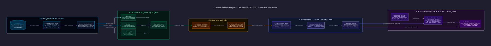
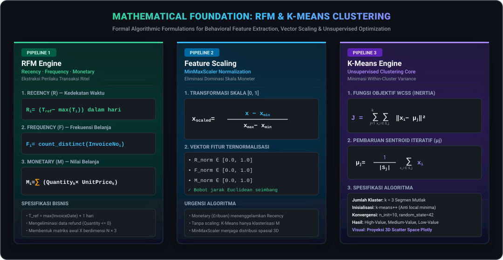

<div align="center">
  <br />
  <h1 align="center">📊 Customer Behavior Analytics</h1>
  <p align="center"><i>UNSUPERVISED CUSTOMER SEGMENTATION · RFM MODELING · 3D CLUSTERING INTELLIGENCE</i></p>

  <a href="https://customer-behavior-analytics-hyfhi.streamlit.app" target="_blank">
    
  </a>
  <br />

  <p align="center">
    <a href="https://customer-behavior-analytics-hyfhi.streamlit.app" target="_blank">
      
    </a>
  </p>

  <p align="center">
    
    
    
    
    
    
    
    
    
  </p>

  <p align="center" style="max-width: 850px; font-size: 1.05rem; color: #94a3b8; line-height: 1.6;">
    <b>Customer Behavior Analytics</b> adalah platform intelijen bisnis berbasis pembelajaran mesin tanpa supervisi (<i>Unsupervised Machine Learning</i>) yang merekayasa segmentasi perilaku pelanggan secara otomatis dan presisi. Menggabungkan model perilaku transaksional <b>RFM (Recency, Frequency, Monetary)</b>, normalisasi vektor <b>MinMaxScaler</b>, optimasi inersia <b>K-Means Clustering</b> (k = 3), dan visualisasi spasial <b>Plotly 3D Interactive Scatter</b>, sistem ini memetakan basis pelanggan e-commerce dan ritel ke dalam 3 segmen strategis (<i>High-Value</i>, <i>Medium-Value</i>, dan <i>Low-Value</i>) secara <i>in-memory</i> tanpa menyimpan data sensitif transaksi ke disk server.
  </p>
</div>

<p align="center"></p>

## 🏛️ Arsitektur Pipeline Machine Learning & Visualisasi 3D

Sistem mengeksekusi pipeline deterministik dari berkas transaksi mentah hingga visualisasi koordinat 3D yang dapat diputar 360 derajat di browser:

<p align="center">
  
</p>

<p align="center"></p>

## ⚡ Fitur Rekayasa Unggulan

<table align="center" width="100%">
  <tr>
    <td width="50%" valign="top">
      <b>🚀 Pemrosesan In-Memory Zero-Residue</b><br/>
      Seluruh unggahan file transaksi ritel (CSV dan Excel <code>.xlsx</code>) diproses langsung di memori RAM menggunakan buffer Pandas. Sistem memfilter data tanpa CustomerID, membuang kuantitas negatif (retur barang), serta menghapus duplikat tanpa pernah menulis berkas transaksi pelanggan ke disk penyimpanan server.
    </td>
    <td width="50%" valign="top">
      <b>📐 Rekayasa Fitur RFM Otomatis</b><br/>
      Mengekstrak 3 parameter fundamental perilaku belanja: <b>Recency</b> (kedekatan hari dari tanggal referensi T_ref = max(InvoiceDate) + 1), <b>Frequency</b> (total nomor faktur unik <code>nunique(InvoiceNo)</code>), dan <b>Monetary</b> (akumulasi nilai belanja <code>sum(Quantity × UnitPrice)</code>) per pelanggan unik.
    </td>
  </tr>
  <tr>
    <td width="50%" valign="top">
      <b>⚖️ Normalisasi Fitur MinMaxScaler [0, 1]</b><br/>
      Nilai belanja moneter (ribuan poundsterling/rupiah) secara alami mendominasi perhitungan jarak Euclidean dibandingkan nilai frekuensi (satuan). Transformasi <code>MinMaxScaler</code> menormalisasi ketiga vektor ke rentang seragam [0, 1], memastikan K-Means mengevaluasi kedekatan spasial pelanggan secara seimbang dan adil.
    </td>
    <td width="50%" valign="top">
      <b>🎯 Engine K-Means Klasterisasi Deterministik</b><br/>
      Mengimplementasikan algoritma <code>KMeans(n_clusters=3, random_state=42, n_init=10)</code> dengan inisialisasi k-means++ untuk mencegah konvergensi ke <i>local minima</i>. Sentroid secara otomatis diurutkan berdasarkan rerata nilai moneter untuk memetakan label klaster 0, 1, dan 2 ke segmen bisnis nyata.
    </td>
  </tr>
  <tr>
    <td width="50%" valign="top">
      <b>🌐 Plotly 3D Interactive Spatial Visualizer</b><br/>
      Proyeksi data pelanggan ke dalam ruang 3 dimensi interaktif (Sumbu X: Recency, Y: Frequency, Z: Monetary). Pengguna dapat memutar sudut pandang (360° orbit), melakukan zoom in/out, menyaring klaster tertentu, dan membaca tooltip nilai individual pelanggan secara <i>real-time</i> di peramban.
    </td>
    <td width="50%" valign="top">
      <b>💼 Dasbor Analitik & Ekspor Rekapitulasi CSV</b><br/>
      Menampilkan kartu metrik eksekutif (Total Pelanggan Aktif, Total Pendapatan, Average Order Value), visualisasi donat proporsi segmen, tabel rerata karakteristik klaster, serta tombol unduh rekapitulasi data RFM terklasterisasi untuk integrasi ke alat CRM atau email marketing.
    </td>
  </tr>
</table>

<p align="center"></p>

## 🧮 Formulasi Matematis RFM & Optimasi K-Means

Seluruh formulasi matematis inti disajikan dalam kartu vektor beresolusi tinggi dengan garis pecahan horizontal dan notasi operator sigma sejati:

<p align="center">
  
</p>

### Ringkasan Tahapan Komputasi Matematis

| Tahapan Pipeline | Formula Utama | Karakteristik Operasional | Peran dalam Sistem |
|---|---|---|---|
| **1. Ekstraksi Recency (R)** | R_i = T_ref − max(T_i) | Menghitung selisih hari sejak transaksi belanja terakhir pelanggan | Indikator loyalitas & risiko churn konsumen |
| **2. Ekstraksi Frequency (F)** | F_i = count_distinct(InvoiceNo_i) | Menghitung akumulasi jumlah transaksi unik per CustomerID | Indikator kebiasaan & keterikatan berbelanja |
| **3. Ekstraksi Monetary (M)** | M_i = Σ (Quantity_k × UnitPrice_k) | Akumulasi total pengeluaran belanja pelanggan | Parameter utama penentu kontribusi pendapatan |
| **4. Normalisasi Vektor** | x_scaled = (x − x_min) / (x_max − x_min) | Mentransformasi seluruh variabel ke interval seragam [0.0, 1.0] | Mencegah skala moneter menenggelamkan frekuensi |
| **5. Optimasi Inersia K-Means** | J = Σ Σ ‖x_i − μ_j‖² | Meminimalkan Within-Cluster Sum of Squares (WCSS) secara iteratif | Membentuk 3 kelompok pelanggan yang padat & terpisah |
| **6. Pembaruan Sentroid** | μ_j = (1 / n_j) · Σ x_i | Mengkalkulasi titik tengah geometris tiap klaster per iterasi | Menemukan representasi rata-rata profil tiap segmen |

<p align="center"></p>

## 👥 Matriks Profil Segmen Pelanggan & Rekomendasi Bisnis

Hasil pengelompokan K-Means dipetakan ke dalam 3 segmen actionable untuk panduan tim pemasaran:

| Segmen Pelanggan | Profil Recency (R) | Profil Frequency (F) | Profil Monetary (M) | Karakteristik Perilaku | Rekomendasi Tindakan Strategis |
|---|:---:|:---:|:---:|---|---|
| **High-Value (Champions)** | **Sangat Baru**<br/>(Rendah) | **Sangat Sering**<br/>(Tinggi) | **Sangat Besar**<br/>(Tinggi) | Pelanggan platinum yang menyumbang porsi terbesar pendapatan. Berbelanja teratur dan baru saja bertransaksi. | **VIP Loyalty Rewards:** Akses awal produk baru, layanan pelanggan prioritas, program membership eksklusif, dan personal gift. |
| **Medium-Value (Regulars)** | **Moderat**<br/>(Sedang) | **Cukup Sering**<br/>(Sedang) | **Menengah**<br/>(Sedang) | Pelanggan aktif rutin dengan volume belanja stabil namun berpotensi ditingkatkan ke segmen champion. | **Upselling & Cross-Selling:** Diskon bundling produk, program poin reward bertingkat, dan rekomendasi produk personal berbasis riwayat. |
| **Low-Value (At-Risk / Churn)** | **Sudah Lama**<br/>(Tinggi) | **Jarang**<br/>(Rendah) | **Kecil**<br/>(Rendah) | Pelanggan pasif yang sudah lama tidak bertransaksi, pembeli satu kali (one-time buyers), atau terindikasi beralih ke kompetitor. | **Win-Back Campaigns:** Kupon reaktivasi khusus "Kami Merindukan Anda", survei kepuasan pelanggan, penawaran diskon terbatas. |

<p align="center"></p>

## 📋 Spesifikasi Format Dataset Masukan

Sistem menerima berkas tabular dalam format **CSV** atau **Excel (`.xlsx`)** dengan struktur kolom transaksi ritel standar:

| Nama Kolom | Tipe Data | Status | Fungsi Operasional dalam Pipeline |
|---|:---:|:---:|---|
| **`CustomerID`** | String / Integer | **Wajib** | Pengenal unik pelanggan. Baris tanpa ID diabaikan secara otomatis. |
| **`InvoiceNo`** | String / Integer | **Wajib** | Nomor faktur transaksi unik untuk kalkulasi metrik Frequency. |
| **`InvoiceDate`** | Datetime / String | **Wajib** | Waktu terjadinya transaksi untuk kalkulasi hari Recency. |
| **`Quantity`** | Integer / Float | **Wajib** | Kuantitas barang. Nilai &le; 0 (pembatalan/retur) difilter keluar. |
| **`UnitPrice`** | Float | **Wajib** | Harga satuan barang. Nilai &le; 0 difilter keluar dari perhitungan. |
| `StockCode` | String | Opsional | Kode SKU barang (tidak memengaruhi clustering RFM). |
| `Description` | String | Opsional | Nama produk/deskripsi transaksi (metadata). |
| `Country` | String | Opsional | Negara asal pembeli untuk analisis demografi tambahan. |

<p align="center"></p>

## 📂 Struktur Direktori Repositori

```text
customer-behavior-analytics/
├── assets/
│   ├── architecture.svg              # Diagram arsitektur pipeline kompilasi D2 (Terminal Dark)
│   └── rfm_kmeans_formulas.svg       # Kartu vektor formulasi matematis RFM & K-Means murni
├── docs/
│   └── architecture.d2               # Kode sumber deklaratif D2 arsitektur sistem
├── .streamlit/
│   └── config.toml                   # Konfigurasi visual theme Streamlit (Clean Palette)
├── main.py                           # Kode aplikasi utama Streamlit, RFM pipeline & Plotly 3D
├── requirements.txt                  # Dependensi runtime Python (streamlit, scikit-learn, plotly)
├── .gitignore                        # Filter proteksi Python, virtualenv, dan dump dataset ritel
└── LICENSE                           # Lisensi resmi MIT (Luthfi Muthathohirin)
```

<p align="center"></p>

## 🚀 Panduan Eksekusi Cepat (*Quickstart*)

### 🌐 Akses Langsung via Web (Cloud Demo)
Aplikasi telah di-deploy dan dapat diakses langsung tanpa instalasi di:
👉 **[https://customer-behavior-analytics-hyfhi.streamlit.app](https://customer-behavior-analytics-hyfhi.streamlit.app)**

---

### 💻 Instalasi & Eksekusi Mandiri di Komputer Lokal

#### 1. Prasyarat Sistem
- **Python**: `v3.10.x`, `v3.11.x`, atau `v3.12.x`
- **pip**: Package manager bawaan Python

#### 2. Kloning Repositori & Penyiapan Virtual Environment
```bash
# 1. Kloning repositori
git clone https://github.com/HyLuthfi/customer-behavior-analytics.git
cd customer-behavior-analytics

# 2. Buat dan aktifkan virtual environment
python -m venv .venv
# Windows (Git Bash / PowerShell):
source .venv/Scripts/activate
# Linux / macOS:
# source .venv/bin/activate

# 3. Pasang seluruh dependensi pustaka
pip install -r requirements.txt
```

#### 3. Menjalankan Dashboard Streamlit
```bash
streamlit run main.py
```
Aplikasi web analitik akan secara otomatis terbuka di peramban Anda pada tautan lokal `http://localhost:8501`. Unggah berkas transaksi ritel sampel Anda pada tab antarmuka untuk memulai klasterisasi.

<p align="center"></p>

## 🛡️ Jaminan Keamanan, Audit & Lisensi

- **Audit Kredensial Bersih (Gitleaks v8.30.1):** Seluruh commit riwayat repositori telah diaudit secara forensik dan mencatat **0 kebocoran rahasia**.
- **Privasi Data Transaksi Terjamin (Zero Storage):** Berkas transaksi pelanggan diproses murni secara *in-memory* di dalam memory buffer Pandas saat sesi peramban berlangsung. Tidak ada database relasional atau file transaksi yang disimpan permanen di disk server.
- **Filter `.gitignore` Hardened (102 Aturan):** Menjamin berkas transaksi konsumen lokal (`*.csv`, `*.xlsx`), cache Python (`__pycache__/`), virtual environment (`.venv/`), dan file konfigurasi rahasia terisolasi total dari git version control.
- **Lisensi Hukum Sah:** Dilisensikan di bawah ketentuan **MIT License**. Hak cipta dipegang penuh oleh **Luthfi Muthathohirin** (`@HyLuthfi`). Lihat berkas [`LICENSE`](LICENSE) untuk dokumen hukum lengkap.

---

<div align="center">
  <p style="font-size: 0.95rem; color: #64748b;">
    Dirancang & Dibangun oleh <b>Luthfi Muthathohirin</b> (<a href="https://github.com/HyLuthfi">@HyLuthfi</a>)<br/>
    Unsupervised Machine Learning & Customer Behavior Analytics Portfolio
  </p>
</div>


